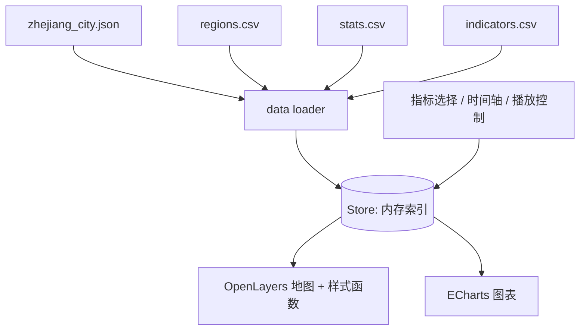

# 浙江省统计专题地图 WebGIS:项目设计文档(v0.2)

> 修订说明(相对 v0.1):行政区划限定到市级;当前只实现任务 1;`pop_density` 采用预计算方案;时间轴支持滑块拖动与自动播放;图表使用 ECharts;任务 2~4 设为待办。

## 1. 项目概述

- **目标**:浙江省 11 个地级市的统计专题地图,支持指标切换、时间轴和图表联动。
- **范围**:行政区划**仅到市级**(1 个省 + 11 个地级市),不做县区级下钻,不引入县级 GeoJSON 与县级数据。
- **技术栈**:OpenLayers + Vite + ECharts。静态文件方案(GeoJSON + CSV),无后端。
- **当前实现目标**:仅任务 1(常住人口、人口密度)。其余指标已在数据规范中预留,但不在当前开发范围内。

## 2. 任务状态

| 任务 | 内容 | 指标 | 状态 |
|---|---|---|---|
| 1 | 人口与密度 | `pop_resident`、`area_land`、`pop_density` | ✅ 数据就绪,**当前开发目标** |
| 2 | GDP 与人均 GDP | `gdp`、`gdp_per_capita` | 🕓 待办(待数据整理) |
| 3 | 产业结构 | `gdp_primary/secondary/tertiary`、`share_*` | 🕓 待办(依赖任务 2) |
| 4 | 收入 | `income_urban_pc` | 🕓 待办 |


## 3. 数据现状(任务 1)

| 文件 | 状态 | 内容 |
|---|---|---|
| `regions.csv` | ✅ | 12 行:1 省 + 11 市,含 `area_land` 与中心点 |
| `stats.csv` | ✅ 仅任务 1 | 11 市 × 2016–2025 × 2 指标 = 220 行 |
| `indicators.csv` | ✅ 已建(任务 1 的 2 项) | 指标元数据 |
| `geo/zhejiang_city.json` | ✅ 已规范化 | 市级边界;来源、许可、坐标参考与区划年份待确认 |

数据特征与注意事项:

- `pop_density = pop_resident × 10000 / area_land`,已抽查杭州、舟山 2016 年与文件一致。
- 省级行(330000)无 `area_land`,`stats` 无省级数据。
- 2019→2020 年多数城市人口明显跳升(如杭州 1036.0 → 1193.6),疑为人口普查口径调整,需在 `note` 与图表中标注。舟山无此跳升。
- 年份范围为 2016–2025,2025 年是否为最终值待确认,暂在 `note` 标注"初步"。

## 4. 数据结构规范

### 4.1 目录

```
public/data/
├─ geo/zhejiang_city.json
├─ regions.csv
├─ stats.csv              # 当前仅含任务 1;后续任务合并进来
├─ indicators.csv
└─ raw/stats_task1.csv    # 各任务原始提交文件
```

### 4.2 `regions.csv`

字段:`adcode, name, short_name, level, parent, area_land, center_lng, center_lat`

- `adcode` 为 6 位字符串,解析时禁止类型推断,须与 GeoJSON 的 `adcode` 类型一致。
- `level` 当前仅 `province | city`。
- `area_land` 单位 km²,静态值。

### 4.3 `stats.csv`(长表)

字段:`adcode, year, indicator, value`

- 每行一个地区、一年、一个指标;主键 `(adcode, year, indicator)`。
- `value` 只放数值,缺失行不写,不用 0 或占位符。
- 单位与口径放在 `indicators.csv`。

### 4.4 指标字典

当前启用:

| indicator | 中文名 | 单位 | 类型 | 存放位置 |
|---|---|---|---|---|
| `pop_resident` | 常住人口 | 万人 | 原始 | stats.csv |
| `pop_density` | 人口密度 | 人/km² | 派生(**预计算**) | stats.csv |
| `area_land` | 行政区面积 | km² | 原始(静态) | regions.csv |

待办(命名已冻结,暂不开发):

| indicator | 中文名 | 单位 | 类型 | 任务 |
|---|---|---|---|---|
| `gdp` | 地区生产总值 | 亿元 | 原始 | 2 |
| `gdp_per_capita` | 人均 GDP | 元/人 | 派生/官方 | 2 |
| `gdp_primary` / `gdp_secondary` / `gdp_tertiary` | 一/二/三产业增加值 | 亿元 | 原始 | 3 |
| `share_primary` / `share_secondary` / `share_tertiary` | 一/二/三产业占比 | % | 派生 | 3 |
| `income_urban_pc` | 城镇居民人均可支配收入 | 元 | 原始 | 4 |

命名规则:前缀表示类别(`pop_`、`gdp_`、`share_`、`income_`),`_pc` 表示人均;指标名确定后不再更改。

### 4.5 派生指标决策:预计算

- 前端**不计算**派生指标,只读取 `stats.csv` 中的预计算值。
- 构建脚本做一致性校验:`|pop_density − pop_resident×10000/area_land| ≤ 0.1`,超限则报错。
- 后续任务的派生指标(`gdp_per_capita`、`share_*`)沿用同一原则。

### 4.6 `indicators.csv`(当前内容)

```csv
indicator,label,unit,decimals,category,type,formula,source,direction,note
pop_resident,常住人口,万人,1,人口,raw,,统计年鉴,neutral,2020年起含普查口径调整;2025年为初步数据
pop_density,人口密度,人/km²,1,人口,derived,pop_resident*10000/area_land,预计算,neutral,
```

## 5. 系统设计



### 5.1 内存索引

```js
// stats: Map<indicator, Map<year, Map<adcode, number>>>
const getValue = (ind, year, code) =>
  stats.get(ind)?.get(year)?.get(code) ?? null;
```

### 5.2 地图

- 市级面图层按当前指标与年份分级设色(choropleth)。
- 切换年份/指标仅调用 `layer.changed()`,不重新读取 GeoJSON。
- 分级断点按指标在**所有年份**的数据统一计算(分位数或自然断点)并固定,保证不同年份颜色含义一致。
- `getValue` 返回 `null` 时显示灰色"无数据"。
- 点击市级要素:高亮并联动图表;不做县级下钻。

### 5.3 时间轴

- 默认:滑块拖动选择年份(范围由 `stats` 中的年份动态得出,当前 2016–2025)。
- 自动播放:播放/暂停按钮,逐年前进,到末年后循环或停止(默认停止,可配置);播放间隔默认 1000 ms,可调。
- 播放状态机:`paused ⇄ playing`;用户拖动滑块时自动转为 `paused`。
- 播放时使用固定断点,避免颜色闪烁。

### 5.4 图表(ECharts)

当前(任务 1)实现:

- **折线图**:选中城市的指标随年份变化,可多选城市对比;当前年份用 `markLine` 标出,2020 年用 `markLine`/`markArea` 标注口径调整。
- **柱状排行图**(可选):当前年份 11 市同指标排序,与地图联动。

待办(任务 3 后):雷达图(三个 `share_*`)、堆叠图(三个 `gdp_*`)。

实现要点:

- 按需引入 ECharts 模块(`echarts/core` + 所需图表与组件)以减小打包体积。
- 图表数据来自同一 Store,与地图共用选中状态(城市、年份、指标)。
- 缺失值用 `null`,折线自然断开,不插值。

### 5.5 目录结构

```
src/
├─ data/     loader.js  store.js  indicators.js
├─ map/      layers.js  style.js  breaks.js
├─ charts/   line.js  rank.js            # radar.js / stacked.js 待办
├─ ui/       indicatorPicker.js  timeline.js  player.js  legend.js
└─ main.js
scripts/
└─ merge_stats.py      # 合并与校验
```

## 6. 数据流水线与校验

`merge_stats.py` 检查项(任一失败即中断):

1. 列名固定为 `adcode,year,indicator,value`。
2. `adcode` 为 6 位字符串,存在于 `regions.csv` 与 GeoJSON。
3. `(adcode, year, indicator)` 无重复。
4. `value` 为数值,无空值/占位符。
5. `indicator` 已在 `indicators.csv` 登记。
6. 派生指标与公式一致(见 4.5)。
7. 输出覆盖率报告(当前应为:11 市 × 10 年 × 2 指标 = 220 行)。

## 7. 开发计划

| 阶段 | 内容 | 状态 |
|---|---|---|
| M0 | Vite 脚手架、数据加载器、`merge_stats.py` 校验 | ✅ 已完成 |
| M1 | 市级底图 + 人口/人口密度分级设色 + 图例 + 指标切换 | ✅ 已完成 |
| M2 | 时间轴(滑块 + 自动播放)+ ECharts 折线图/排行图 + 地图联动 | 下一步 |
| M3 | GDP 与人均 GDP | 待办(任务 2) |
| M4 | 产业结构雷达图、堆叠图 | 待办(任务 3) |
| M5 | 收入指标 | 待办(任务 4) |

M0~M2 验收标准:

- 11 市均能按年份着色,拖动滑块与自动播放均正常且颜色稳定。
- 点击城市,折线图联动显示该市 2016–2025 序列。
- 校验脚本在当前数据上全部通过。

M1 实现说明:

- 分级采用全部年份有效观测值的五级最近秩分位数,断点取实际数据值并去重;相等值归入断点所在的较低一级。无有效数据时仅显示“无数据”图例。
- 地图仅初始化时解析市级边界,按 GeoJSON 经纬度假设从 EPSG:4326 投影到 EPSG:3857;原始坐标参考仍待核实。不使用外部底图服务。
- 地图与数据表共享城市多选状态,选中城市显示高亮边界和当前指标值;数据表按钮支持键盘选择。当前显示最新年份,年份控件与 ECharts 图表留待 M2。

## 8. 风险与待确认

- **口径断点**:2020 年人口普查口径调整,需在 UI 注明。
- **2025 年数据**:确认是否为最终值。
- **市级 GeoJSON 来源**:确认来源、许可与审图号要求;`adcode` 须与 `regions.csv` 对齐。
- **区划版本**:统一使用最新市级区划(浙江 11 个地级市),并在文档中记录区划年份。
- **已移出范围**:县区级下钻、县级 GeoJSON 与县级数据(本版不做)。
